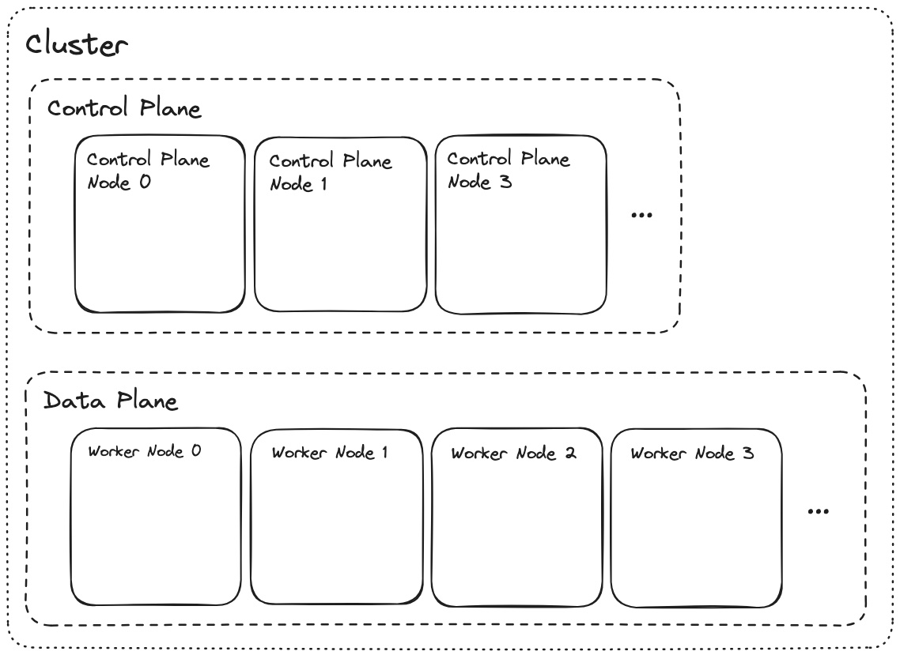
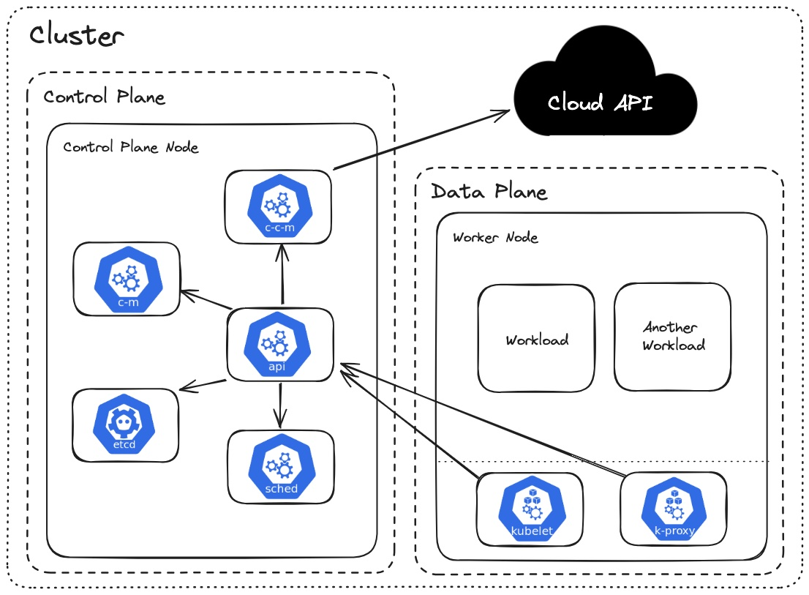

# Обзор технологий

> 🌐 [English](README.md) | Русский

## Планы и узлы

Первые концепции, которые необходимо понять применительно к Kubernetes:

- **Узел:** «узел» — это компьютер/сервер. Несколько узлов объединяются, образуя «кластер».
- **Control Plane:** подмножество узлов в кластере, выделенное для выполнения системных задач. Узлы, входящие в состав control plane, называются «узлами control plane».
- **Data Plane:** подмножество узлов в кластере, выделенное для запуска пользовательских рабочих нагрузок. Узлы, входящие в состав data plane, называются «рабочими узлами».

## Системные компоненты Kubernetes

Kubernetes состоит из множества более мелких компонентов:

- **etcd**: key-value хранилище, используемое для хранения всех данных кластера. Оно служит источником истины для состояния и конфигурации кластера.

- **kube-apiserver**: фронтенд control plane Kubernetes.

- **kube-scheduler**: планирует размещение Pod'ов на подходящих узлах с учётом доступности ресурсов и других ограничений.

- **kube-controller-manager**: запускает процессы контроллеров. Каждый контроллер — это отдельный процесс, который управляет рутинными задачами, такими как поддержание желаемого состояния ресурсов, управление репликацией, обработка операций с узлами и т.д.

- **cloud-controller-manager**: интегрируется с используемым облачным провайдером (если кластер работает в облаке) для управления специфичными для облака ресурсами. Выполняет такие задачи, как управление балансировщиками нагрузки, хранилищем и сетью.

- **kubelet**: агент, который работает на каждом рабочем узле и следит за тем, чтобы контейнеры были запущены в Pod'ах, а также управляет жизненным циклом контейнеров.

- **kube-proxy**: этот сетевой прокси работает на каждом узле и поддерживает сетевые правила, обеспечивающие связь с Pod'ами и от них.

- 
