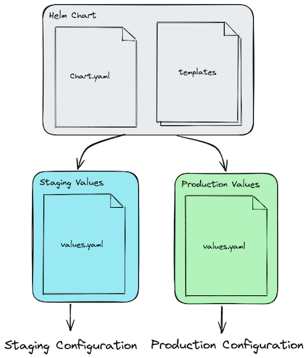

# Helm

> 🌐 [English](README.md) | Русский

Helm (https://helm.sh/) стал де-факто стандартом для упаковки и распространения приложений для Kubernetes.

Он позволяет собирать вместе множество ресурсов Kubernetes и использует язык шаблонизации Go для создания пользовательских интерфейсов, чтобы потребители чарта могли настроить установку под свои нужды.



Тот факт, что Helm наиболее популярен, не означает, что это единственный (или даже лучший) способ упаковки приложений для Kubernetes. В `12-deploying-to-multiple-environments` я рассмотрю дополнительные методы, но Helm настолько распространён, что о нём стоит рассказать и здесь.

## Пример со сторонним чартом

### Bitnami/Postgresql

Мы будем использовать популярный open source чарт для установки PostgreSQL, чтобы показать типовые действия, которые вы будете выполнять при работе со сторонними чартами.

https://github.com/bitnami/charts/tree/main/bitnami/postgresql

- `helm repo add`: добавляет репозиторий чартов Bitnami в локальный список репозиториев чартов Helm.
- `helm search repo`: выполняет поиск доступных чартов в репозитории Bitnami.
- `oras repo tags`: выполняет поиск тегов в OCI-совместимом реестре.
- `helm pull`: скачивает чарт PostgreSQL на локальную машину.
- `helm show values`: отображает значения по умолчанию, используемые чартом.
- `helm install`: устанавливает чарт PostgreSQL в кластере Kubernetes.
- `helm upgrade`: обновляет развёрнутый релиз PostgreSQL до более новой версии чарта.
- `helm rollback`: откатывает релиз PostgreSQL к предыдущей версии.
- `helm list`: выводит список релизов Helm, развёрнутых в кластере Kubernetes.
- `helm get values`: получает значения, использованные для развёрнутого релиза PostgreSQL.
- `helm get manifests`: показывает манифесты Kubernetes развёрнутого релиза PostgreSQL.
- `helm-uninstall`: удаляет релиз PostgreSQL из кластера Kubernetes.

## Примеры собственных чартов

### Helm Create

CLI Helm предоставляет команду, которую можно использовать для создания нового чарта:

```
helm create <CHART_NAME>
```

Это отправная точка с необходимым шаблонным кодом для создания чарта, а также демонстрация многих возможностей Helm. Если вы используете это как основу для собственного чарта, файлы в директории `templates` нужно будет заменить на свои.

В репозитории содержится немодифицированная версия этого чарта для изучения.

### Минимальный пример

Супер-минимальный пример чарта Helm, который развёртывает один `ConfigMap`. Хотя конфигурация минимальна, в нём используются следующие возможности шаблонизации Helm, покрывающие большинство разнообразных сценариев использования, требуемых для большинства чартов:

1. переменные (`define`)
2. условные конструкции (`if`)
3. циклы (`range`)
4. `.Release`
5. `.Chart`
6. `.Values`
