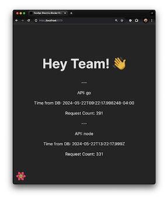
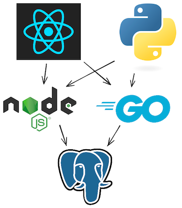

# Демо-приложение

> 🌐 [English](README.md) | Русский

## Минимальное трёхзвенное веб-приложение

- **React frontend:** Использует react query для загрузки данных из двух API и отображения результата.
- **API на Node.js и Go:** У обоих есть эндпоинты `/` и `/ping`. `/` запрашивает у базы данных текущее время и количество запросов к каждому API, записанных в базе данных, а `/ping` возвращает `pong`.
- **База данных Postgres:** Пустая база данных PostgreSQL без таблиц и данных. Используется, чтобы показать, как настроить подключение. Приложения API выполняют запрос `SELECT NOW() as now;`, чтобы определить текущее время для возврата.
- **Генератор нагрузки на Python:** Опрашивает один из API — Node.js или Go — с настраиваемой скоростью.

Демо-приложение основано на приложении из [DevOps Directive Docker Course](https://github.com/sidpalas/devops-directive-docker-course/tree/main/05-example-web-application).

Оно добавляет простой генератор нагрузки, написанный на Python, и простую схему базы данных для отслеживания запросов к каждому API.

## Запуск приложения

Хотя весь смысл этого курса в том, что вам, скорее всего, не захочется/не понадобится запускать приложение локально, мы можем сделать это в качестве отправной точки.

Taskfile содержит команды для запуска каждого приложения:

### Postgres

Гораздо удобнее запускать postgres в контейнере, поэтому мы так и поступим.

`task postgresql:run-postgres` запустит postgres в контейнере и опубликует порт 5432 из контейнера на ваш localhost.

**🚨 ПРИМЕЧАНИЕ:** После запуска базы данных нужно выполнить файл миграции из `./postgresql/migrations`, чтобы создать таблицу, которую используют API. Это можно сделать с помощью `postgresql:run-psql-init-script`.

### api-node

Чтобы запустить API на Node.js, нужно выполнить `task api-node:install` для установки зависимостей.

После установки зависимостей `task api-node:run` запустит API в режиме разработки с nodemon, который перезапускает приложение при изменении исходного кода.

### api-golang

Чтобы запустить API на Go, нужно выполнить `task api-golang:install`.

После установки зависимостей `task api-golang:run` соберёт и запустит API.

### client-react

Как и для api-node, сначала нужно установить зависимости с помощью `task client-react:install`.

После установки зависимостей `task client-react:run` с помощью vite запустит React-приложение в режиме разработки.

### load-generator-python

Этот сервис использует poetry для управления зависимостями. Вам нужно установить зависимости с помощью `task load-generator-python:install`.

После установки зависимостей `task load-generator-python:run` запустит приложение.
