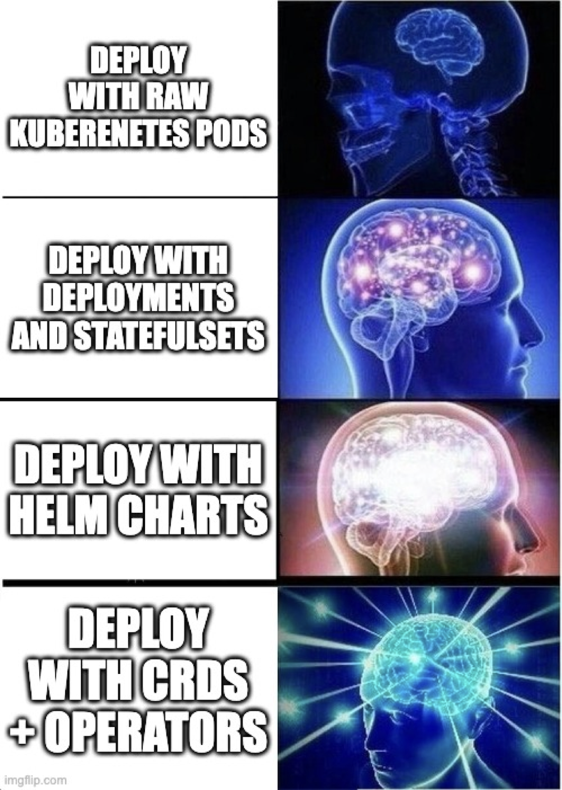

# Расширение Kubernetes

> 🌐 [English](README.md) | Русский

Базовая функциональность Kubernetes предназначена для развёртывания и эксплуатации приложений на основе контейнеров.

При этом идея `Declarative State` + `Continuous Reconciliation` — мощная концепция, которую можно применить к самым разным сценариям использования! Вместо того чтобы пытаться включить в Kubernetes все возможные сценарии, авторы предусмотрели способ определять пользовательские ресурсы, которые каждый может использовать для расширения Kubernetes API.

Авторы создают `CustomResourceDefinitions` (CRD), которые позволяют Kubernetes хранить эти ресурсы в `etcd`. Затем эти CRD можно использовать в собственных «Controllers» или «Operators» для решения самых разных задач.



## Примеры

### Расширение существующих возможностей

В предыдущем разделе мы установили и настроили `Traefik`. Хотя Kubernetes из коробки предоставляет некоторые возможности ingress, Traefik расширил их собственным набором ресурсов. Их можно увидеть, выполнив (после его установки):

```
❯ k api-resources | grep traefik.containo.us/v
ingressroutes                                  traefik.containo.us/v1alpha1           true         IngressRoute
ingressroutetcps                               traefik.containo.us/v1alpha1           true         IngressRouteTCP
ingressrouteudps                               traefik.containo.us/v1alpha1           true         IngressRouteUDP
middlewares                                    traefik.containo.us/v1alpha1           true         Middleware
middlewaretcps                                 traefik.containo.us/v1alpha1           true         MiddlewareTCP
serverstransports                              traefik.containo.us/v1alpha1           true         ServersTransport
tlsoptions                                     traefik.containo.us/v1alpha1           true         TLSOption
tlsstores                                      traefik.containo.us/v1alpha1           true         TLSStore
traefikservices                                traefik.containo.us/v1alpha1           true         TraefikService
```

Они предоставляют дополнительную функциональность сверх официальной спецификации Ingress Kubernetes.

### Встраивание логики operator'а

Stateful-приложениям часто требуются операции, выполняемые в строго определённой последовательности, чтобы обеспечить целостность данных. Такую логику бывает сложно выразить с помощью стандартных типов ресурсов, предоставляемых Kubernetes (например, StatefulSet).

Другой подход — определить пользовательские ресурсы и operator, чтобы выразить эту логику. В этом сценарии приложение-operator выполняет многие из тех задач, которые раньше выполнял человек. Отличный пример такого подхода (мы рассмотрим его в следующем разделе) — CloudNativePG (https://cloudnative-pg.io/).

Этот operator устанавливает следующие CRD:

```
❯ k api-resources | grep postgres
backups                                        postgresql.cnpg.io/v1                  true         Backup
clusterimagecatalogs                           postgresql.cnpg.io/v1                  false        ClusterImageCatalog
clusters                                       postgresql.cnpg.io/v1                  true         Cluster
imagecatalogs                                  postgresql.cnpg.io/v1                  true         ImageCatalog
poolers                                        postgresql.cnpg.io/v1                  true         Pooler
scheduledbackups                               postgresql.cnpg.io/v1                  true         ScheduledBackup
```

Благодаря им конечный пользователь может развёртывать кластеры PostgreSQL через простой интерфейс, а также получать такие возможности, как резервное копирование и пулы соединений (connection pooling).

### Развёртывание внешней инфраструктуры

Operator'ы не обязаны работать только с ресурсами внутри кластера. Например, Crossplane (https://www.crossplane.io/) — это инструмент Infrastructure as Code (вроде Terraform), работающий внутри Kubernetes.

Пользовательские ресурсы отображаются на внешние облачные ресурсы, а приложение Crossplane берёт на себя их развёртывание и управление ими. Этот подход интересен тем, что благодаря природе control loop Kubernetes он обеспечивает автоматическое обнаружение/устранение дрейфа без каких-либо дополнительных усилий!
