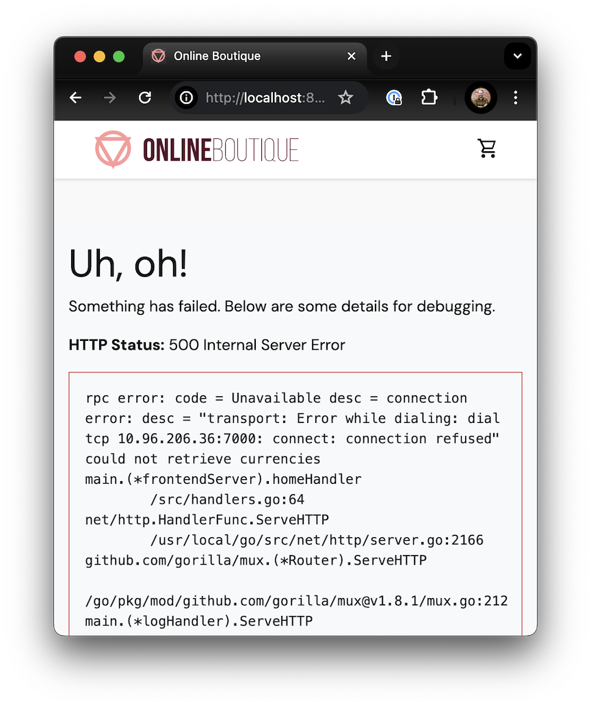

# Отладка в Kubernetes

> 🌐 [English](README.md) | Русский

Иногда что-то идёт не так. Этот раздел призван показать вам ошибки в конфигурации, которые могут приводить к проблемам, а также то, как их найти и исправить.

## Приложение

Приложение, используемое в этом разделе, — https://github.com/GoogleCloudPlatform/microservices-demo, но с несколькими намеренно внесёнными поломками.

Конкретные изменения, которые я внёс в конфигурацию, можно найти здесь: https://github.com/sidpalas/microservices-demo/pull/1. Тем не менее, НЕ СМОТРИТЕ туда, пока не пройдёте процесс отладки самостоятельно.

## Блок-схема

Ребята из [Learn K8s](https://learnk8s.io/) опубликовали очень полезную статью и блок-схему для устранения неполадок при развёртывании в Kubernetes:

https://learnk8s.io/troubleshooting-deployments

Это может стать отличной структурой для вашего процесса отладки.
