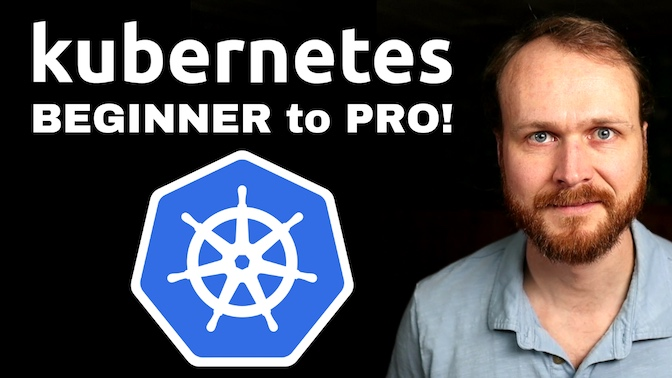

# DevOps Directive Kubernetes Course

> 🌐 [English](README.md) | Русский

Это репозиторий-спутник курса: [Полный курс по Kubernetes — от BEGINNER до PRO](https://www.youtube.com/watch?v=2T86xAtR6Fo)

## Как пользоваться этим репозиторием

Каждая директория в репозитории соответствует одному разделу курса. Сделайте fork репозитория, проходите уроки вместе с ним и используйте/обновляйте/изменяйте примеры кода по мере необходимости.

В курсе используется ряд программных инструментов. Инструкции по оптимальному способу их настройки можно найти в разделе [03-installation-and-setup](03-installation-and-setup/README.md).

## Разделы курса

### [01 — История и мотивация](01-history-and-motivation/README.md)

Рассматривается эволюция эксплуатации программного обеспечения и то, как она привела к появлению оркестрации контейнеров + Kubernetes.

### [02 — Обзор технологий](02-technology-overview/README.md)

Даёт высокоуровневый обзор архитектуры Kubernetes и ключевых концепций, таких как узлы, control plane и data plane.

### [03 — Установка и настройка](03-installation-and-setup/README.md)

Помогает настроить окружение и установить необходимые для курса инструменты.

### [04 — Встроенные типы ресурсов](04-built-in-resource-types/README.md)

Охватывает основные типы ресурсов, предоставляемые Kubernetes, и способы работы с ними.

### [05 — Helm](05-helm/README.md)

Знакомит с Helm и тем, как использовать его для собственных приложений и установки сторонних приложений.

### [06 — Демо-приложение](06-demo-application/README.md)

Разбирает трёхзвенное веб-приложение, которое мы будем использовать как основу для углубления понимания развёртывания в Kubernetes.

### [07 — Развёртывание демо-приложения](07-deploying-demo-application/README.md)

Содержит манифесты ресурсов для развёртывания демо-приложения в Kubernetes.

### [08 — Расширение Kubernetes](08-extending-kubernetes/README.md)

Обсуждает, как приложения используют CRD и operator'ы для расширения возможностей Kubernetes.

### [09 — Вспомогательные инструменты](09-deploying-auxiliary-tooling/README.md)

Развёртывает полезные сторонние инструменты, расширяющие ваше Kubernetes-окружение.

### [10 — Опыт разработчика](10-developer-experience/README.md)

Сфокусирован на улучшении опыта разработчика при работе с Kubernetes.

### [11 — Отладка](11-debugging/README.md)

Учит методам отладки проблем внутри вашего Kubernetes-кластера.

### [12 — Развёртывание в нескольких окружениях](12-deploying-to-multiple-environments/README.md)

Рассматривает стратегии развёртывания приложений в несколько окружений с помощью Kubernetes.

### [13 — Обновление кластера и узлов](13-cluster-and-node-upgrades/README.md)

Содержит рекомендации по обновлению Kubernetes-кластеров и узлов.

### [14 — CI/CD](14-cicd/README.md)

Обсуждает, как реализовать системы непрерывной интеграции и непрерывной поставки (CI/CD) для приложений на базе Kubernetes.
